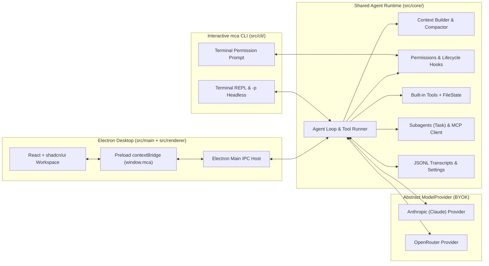

# Implementation Plan: mini-coding-agent (MCA)

This plan adapts the **Build Claude Code from scratch** architecture (`mini-claude`, Stages 1–14) into **mini-coding-agent (MCA)**: a macOS-first **Electron + React + TypeScript + shadcn/ui** desktop app **and** an interactive **`mca` CLI** (like `claude` / `agy`), sharing one provider-agnostic TypeScript agent runtime.

---

## Key Architectural Decisions

1. **Multi-Provider & Claude Compatibility**:
   - Primary config & storage: `.mca/` (project) and `~/.mca/` (user).
   - Project instructions & extensions load with compatibility fallbacks: `AGENTS.md`, `CLAUDE.md`, `CLAUDE.local.md`, `.mcp.json`, plus `.mca/` and `.claude/` `settings.json`, `commands/*.md`, and `skills/<name>/SKILL.md`.
2. **Abstract `ModelProvider` with BYOK (Anthropic + OpenRouter)**:
   - Provider-agnostic streaming interface (`ModelProvider`) normalizing messages, tool definitions, tool calls, stop reasons, and token usage.
   - First two providers: **Anthropic (Claude)** (`@anthropic-ai/sdk`, with prompt caching `cache_control: ephemeral`) and **OpenRouter** (OpenAI-compatible streaming API supporting Claude, GPT, Gemini, DeepSeek, etc.).
   - **BYOK (Bring Your Own Key)**: Reads `ANTHROPIC_API_KEY` / `OPENROUTER_API_KEY` from environment or user-configured keys (stored via Electron `safeStorage` in desktop mode and `0600` `~/.mca/credentials.json` in CLI mode).
3. **Dual Frontends (`mca` CLI + Electron Desktop App)**:
   - Shared pure-Node runtime in `src/core/` with zero Electron imports.
   - **`mca` CLI** (`bin: { "mca": "./out/cli/index.js" }`): Interactive terminal REPL (streaming `⏺`/`⎿` output, permission prompts, slash commands, `Ctrl+C` abort, `--continue`, and `-p "<prompt>"` headless mode).
   - **Electron Desktop App**: React + Tailwind CSS v4 + shadcn/ui workspace communicating with `src/core/` over typed IPC.

---

## Architecture Overview



### Core Design Principles
1. **One loop**: Single streaming model-call → tool-execution → repeat loop; subagents reuse the exact same loop with fresh history and `readState`.
2. **Few, sharp tools**: 11 focused built-in tools (`Read`, `Write`, `Edit`, `Glob`, `Grep`, `Bash`, `TodoWrite`, `ExitPlanMode`, `Task`, `WebFetch`, `Skill`) + dynamic MCP tools.
3. **Search like a developer**: `Glob` (`fast-glob`) + `Grep` (`ripgrep`) + `Read` — exact on symbols, never stale.
4. **Read before write**: `Edit`/`Write` verify `mtimeMs` against `readState` and record per-turn rewind checkpoints.
5. **Human holds the keys**: Read-only tools auto-run in parallel; mutating tools pass through permission modes, allow/ask/deny rules, and an interactive approval prompt (terminal or desktop modal).
6. **Context is the budget**: Output truncation, subagents for broad exploration, cheap-model summarization for `WebFetch`, and auto-compaction at 80% context window.
7. **Everything is a file**: `AGENTS.md` / `CLAUDE.md` / `CLAUDE.local.md`, `.mcp.json`, `.mca/settings.json` (and `.claude/settings.json`), `commands/*.md`, `skills/<name>/SKILL.md`, and `~/.mca/projects/<project>/<id>.jsonl`.

---

## Target Project Structure

```text
src/
├── shared/
│   └── types.ts                  # Shared IPC, UI, Provider, Tool, Permission, Todo types
├── core/                         # Pure Node/TS runtime (shared by CLI & Electron Main)
│   ├── provider/
│   │   ├── types.ts              # ModelProvider interface, canonical Message/Tool/StreamEvent
│   │   ├── anthropic.ts          # Anthropic (Claude) BYOK streaming provider
│   │   ├── openrouter.ts         # OpenRouter BYOK streaming provider
│   │   └── factory.ts            # Provider registry & model routing (main + fast/cheap model)
│   ├── tool.ts                   # Stage 1: Tool<S> contract, toSchema(), truncate()
│   ├── agent.ts                  # Stage 2: runTurn(), runTools(), runOne(), runSubagent()
│   ├── registry.ts               # Built-in + MCP tools in stable order
│   ├── filestate.ts              # Stage 3: read-before-write mtime map + rewind checkpoints
│   ├── permissions.ts            # Stage 6: modes, allow/ask/deny rules, prompt adapter
│   ├── hooks.ts                  # Stage 7: lifecycle shell hooks (stdin JSON, exit 2 = block)
│   ├── context.ts                # Stage 8: system prompt, AGENTS.md/CLAUDE.md hierarchy, git snapshot
│   ├── compact.ts                # Stage 11: 80% context window auto-compaction
│   ├── session.ts                # Stage 11: JSONL transcripts & --continue
│   ├── mcp.ts                    # Stage 12: stdio MCP client (.mcp.json)
│   ├── settings.ts               # Merge global (~/.mca), project (.mca/.claude), and local settings + BYOK keys
│   ├── commands.ts               # Stage 13: slash command loader & $ARGUMENTS expansion
│   └── tools/
│       ├── files.ts              # Stage 3: Read, Write, Edit
│       ├── search.ts             # Stage 4: Glob, Grep (rg)
│       ├── bash.ts               # Stage 5: Bash (persistent cwd, timeout, AbortSignal)
│       ├── todo.ts               # Stage 9: TodoWrite
│       ├── plan.ts               # Stage 9: ExitPlanMode
│       ├── task.ts               # Stage 10: Task (general-purpose & Explore subagents)
│       ├── web.ts                # Stage 10: WebFetch (fast-model extraction)
│       └── skill.ts              # Stage 13: Skill progressive loader
├── cli/                          # Stage 14: Interactive `mca` CLI + `-p` headless mode
│   ├── index.ts                  # Entrypoint (`#!/usr/bin/env node`), arg parsing, REPL, Ctrl+C
│   ├── ui.ts                     # Terminal renderer (⏺/⎿ transcript, spinners, permission/plan prompts)
│   └── credentials.ts            # CLI BYOK key lookup (env + ~/.mca/credentials.json)
├── main/                         # Electron Main Process
│   ├── index.ts                  # BrowserWindow + IPC handlers wrapping src/core/
│   └── credentials.ts            # Electron safeStorage BYOK key persistence
├── preload/
│   ├── index.ts                  # contextBridge.exposeInMainWorld('mca', ...)
│   └── index.d.ts                # Window.mca type declarations
└── renderer/src/                 # Electron Desktop UI (React + Tailwind v4 + shadcn/ui)
    ├── App.tsx                   # Main workspace shell
    ├── components/
    │   ├── ui/                   # shadcn/ui primitives
    │   ├── ChatTranscript.tsx    # Streaming markdown + ⏺/⎿ tool-call activity cards
    │   ├── PromptInput.tsx       # Composer, slash-command autocomplete, model/mode selector, Stop
    │   ├── PermissionDialog.tsx  # 3-option approval modal (Yes / Session-allow / No + feedback)
    │   ├── PlanApprovalSheet.tsx # Markdown plan review + Approve/Reject for ExitPlanMode
    │   ├── TodoSidebar.tsx       # Live TodoWrite checklist + workspace & session switcher
    │   └── SettingsDialog.tsx    # Provider & BYOK key setup (Anthropic / OpenRouter), rules, MCP
    └── hooks/
        └── useAgentSession.ts    # Subscribes to Main IPC stream events
```

---

## Dependencies to Install

### Runtime Packages
- `@anthropic-ai/sdk` — Anthropic (Claude) Messages streaming API
- `zod` — Tool input schema validation & JSON Schema conversion (`z.toJSONSchema`)
- `fast-glob` — Fast file pattern matching for `Glob`
- `@modelcontextprotocol/sdk` — Stdio MCP client for `.mcp.json` servers
- *(OpenRouter uses Node 22 built-in `fetch` + SSE streaming parser — no extra SDK required)*

### shadcn/ui Components (Added Incrementally)
- `scroll-area`, `textarea`, `input`, `select`, `dialog`, `separator`, `tabs`, `tooltip`, `switch`, `sheet`

---

## Build Milestones

### Milestone 1: Abstract BYOK Providers, Core Loop & `mca` + Desktop Streaming (Stages 1–2)
**Goal**: Provider-agnostic streaming loop working with both **Anthropic** and **OpenRouter** (BYOK), testable from both the Electron app and a minimal `mca` CLI.
- [ ] Add `@anthropic-ai/sdk` and `zod` to `package.json`, plus `bin: { "mca": "./out/cli/index.js" }` and CLI build script.
- [ ] Implement `src/core/provider/` (`types.ts`, `anthropic.ts`, `openrouter.ts`, `factory.ts`) with normalized streaming events (`text_delta`, `tool_use`, `usage`, `stop_reason`) and BYOK key resolution.
- [ ] Implement `src/core/tool.ts`: `ToolContext`, `Tool<S>`, `toToolDefinition()`, and middle-preserving `truncate()`.
- [ ] Implement `src/core/agent.ts`: `Session`, `runTurn()`, `runTools()` (parallel batching for consecutive `readOnly` calls, sequential for mutating calls), `runOne()`, and `runSubagent()`.
- [ ] Wire Electron Main IPC (`agent:send`, `agent:abort`, `agent:selectWorkspace`, `settings:setKey`, `agent:event`) and build `ChatTranscript.tsx`, `PromptInput.tsx`, and initial `SettingsDialog.tsx` (provider + BYOK key input).
- [ ] Add Vitest unit tests for both provider adapters (mocked SSE/SDK streams), `truncate()`, and parallel-vs-sequential `runTools()` ordering.

### Milestone 2: File Tools, Read-Before-Write & Checkpoints (Stage 3)
**Goal**: Safe file reading, editing, creation, and single-turn `/rewind`.
- [ ] Implement `src/core/filestate.ts`: `readState` (`mtimeMs` tracking), `assertFresh()`, `beginCheckpoint()`, `recordBefore()`, and `rewind()`.
- [ ] Implement `src/core/tools/files.ts`:
  - `Read` (`readOnly: true`, 1-based line numbers, offset/limit, 2,000-char line cap).
  - `Write` (`readOnly: false`, freshness check, checkpoint, `mkdir -p`).
  - `Edit` (`readOnly: false`, freshness check, exact-match uniqueness unless `replace_all`, callback replacer `() => new_string` to avoid `$&`/`$1` bugs).
- [ ] Wire **Rewind last turn** in the desktop UI and `/rewind` command.
- [ ] Add Vitest tests covering unread/stale `Edit` rejection, literal `$&` replacement safety, and `/rewind` restoring/deleting files.

### Milestone 3: Search & Persistent Bash Execution (Stages 4–5)
**Goal**: Developer-grade codebase exploration and shell execution.
- [ ] Add `fast-glob` and implement `src/core/tools/search.ts`:
  - `Glob` (`readOnly: true`, ignores `node_modules`/`.git`, sorted by `mtimeMs` desc, 100-result cap).
  - `Grep` (`readOnly: true`, spawns `rg` with `files_with_matches` default or `content` mode, `--max-columns 300`, 20k truncation, exit code `1` → `"No matches."`).
- [ ] Implement `src/core/tools/bash.ts`:
  - `Bash` (`readOnly: false`, `$PWD` sentinel marker to persist `ctx.cwd`, 120s default / 600s max timeout, `AbortSignal` kill, 30k combined output truncation).
- [ ] Add Vitest tests for `Glob` sorting, `Grep` no-match handling, and `Bash` persistent `cd` + timeout + abort.

### Milestone 4: Permissions Engine, Modes & Approval UI (Stage 6)
**Goal**: Full human-in-the-loop safety model across desktop and CLI.
- [ ] Implement `src/core/settings.ts` (merging `~/.mca/settings.json`, `.mca/settings.json`, `.claude/settings.json`, and `*.local.json`) and `src/core/permissions.ts`:
  - Modes: `default`, `acceptEdits`, `plan`, `bypassPermissions`.
  - Rule matching: `Read`, `Bash(npm run test:*)`, `Edit(src/**)`, `Read(./.env)`, `WebFetch(domain:...)`.
  - 7-step waterfall: `deny` → `ask` → `bypassPermissions` → `readOnly` → `plan` → `allow`/`sessionAllow` → `acceptEdits` → interactive prompt callback.
- [ ] Build `PermissionDialog.tsx` (Electron IPC promise bridge) with 3 choices: **Yes**, **Yes & remember this session**, **No + optional feedback**.
- [ ] Add mode selector and rules inspector to the desktop UI.
- [ ] Add Vitest permission matrix tests covering all 4 modes and rule precedence.

### Milestone 5: Lifecycle Hooks & Context / `AGENTS.md` + `CLAUDE.md` Loader (Stages 7–8)
**Goal**: Extensible shell hooks and cache-optimized project context.
- [ ] Implement `src/core/hooks.ts`: `SessionStart`, `UserPromptSubmit`, `PreToolUse`, `PostToolUse`, `Stop` shell hooks with JSON on `stdin` (60s timeout; exit code `2` blocks and feeds `stderr` back to the model).
- [ ] Implement `src/core/context.ts`:
  - Stable system prompt (with Anthropic `cache_control: { type: "ephemeral" }` when using Claude).
  - First-turn `<system-reminder>` with hierarchical `AGENTS.md`, `CLAUDE.md`, `CLAUDE.local.md` discovery + recursive `@import` expansion (depth ≤ 5), git branch/status/recent commits snapshot, and skills index.
- [ ] Add Vitest tests for `@import` cycle/depth protection, multi-file discovery order, and hook exit-code-2 blocking.

### Milestone 6: Planning Tools, Subagents & WebFetch (Stages 9–10)
**Goal**: Structured task tracking, plan approval workflow, parallel exploration subagents, and safe web reading.
- [ ] Implement `src/core/tools/todo.ts` (`TodoWrite`) + `TodoSidebar.tsx` live checklist UI.
- [ ] Implement `src/core/tools/plan.ts` (`ExitPlanMode`) + `PlanApprovalSheet.tsx` (approving switches mode from `plan` → `default`).
- [ ] Implement `src/core/tools/task.ts` (`Task` tool spawning `runSubagent()` for `general-purpose` and read-only `Explore` subagents, excluding `Task` to prevent recursion).
- [ ] Implement `src/core/tools/web.ts` (`WebFetch` stripping HTML and summarizing via configured fast/cheap model — e.g. Haiku on Anthropic or configured fast model on OpenRouter — with prompt-injection boundary).
- [ ] Render subagent activity nested in `ChatTranscript.tsx`.

### Milestone 7: Sessions (JSONL), Auto-Compaction & MCP Servers (Stages 11–12)
**Goal**: Resumable conversations, long-session memory management, and external tool integration.
- [ ] Implement `src/core/session.ts`: append-only JSONL transcripts under `~/.mca/projects/<sanitized-root>/<id>.jsonl` with list/resume (`--continue` in CLI, session picker in desktop UI).
- [ ] Implement `src/core/compact.ts`: auto-trigger at `lastInputTokens > 0.8 * contextWindow` + manual `/compact [focus]` generating a 7-section summary and clearing `readState`.
- [ ] Add `@modelcontextprotocol/sdk` and implement `src/core/mcp.ts`: load `.mcp.json`, connect stdio servers via `StdioClientTransport`, register `mcp__<server>__<tool>` in `registry.ts`, and show server status in Settings.

### Milestone 8: Skills, Slash Commands, Full Interactive `mca` CLI & Verification (Stages 13–14)
**Goal**: Complete interactive `mca` CLI, progressive skills, custom slash commands, and full CI/macOS verification.
- [ ] Implement `src/core/tools/skill.ts` (progressive disclosure of `.mca/skills/<name>/SKILL.md` and `.claude/skills/<name>/SKILL.md`) and `src/core/commands.ts` (custom `/name args` expanding `commands/<name>.md` with `$ARGUMENTS`, plus built-ins `/help`, `/clear`, `/compact`, `/mode`, `/model`, `/provider`, `/rewind`, `/exit`).
- [ ] Complete `src/cli/index.ts` & `src/cli/ui.ts`:
  - Interactive `mca` terminal interface (streaming `⏺`/`⎿` output, numbered permission prompts, plan approval prompt, slash commands, `Ctrl+C` abort, `--continue`, `--provider`, `--model`).
  - Headless `-p "<prompt>"` single-shot mode for scripting and automated evals.
  - Ensure `npm link` / `npx mca` launches cleanly on macOS.
- [ ] Full verification suite:
  - `npm run typecheck`
  - `npm test` (unit + provider + CLI + React component tests)
  - `npm run build` (Electron app + `mca` CLI bundle)
  - `npm run package:mac` (verified in `.github/workflows/ci.yml` on `macos-latest`)

---

## Verification Plan
- **Automated Tests (Vitest)**: Unit tests per `src/core/` module (`provider/anthropic`, `provider/openrouter`, `tool`, `agent`, `filestate`, `files`, `search`, `bash`, `permissions`, `hooks`, `context`, `compact`, `session`, `commands`) + React Testing Library tests for `App`, `ChatTranscript`, `PermissionDialog`, and `SettingsDialog`.
- **CI Pipeline**: `.github/workflows/ci.yml` runs `typecheck`, `test`, `build`, and `package:mac` on `macos-latest` for every push/PR to `main`.
- **Manual Smoke Tests (macOS)**:
  - Desktop (`npm run dev`): Configure Anthropic or OpenRouter BYOK key, open a local repo, run a prompt triggering `Read` → `Grep` → `Edit` (approve in modal) → `Bash(npm test)` → `/rewind`.
  - CLI (`mca`): Run interactive session in a repo, test slash commands (`/mode`, `/model`, `/rewind`, `/compact`), and test `mca -p "summarize this repo"`.
