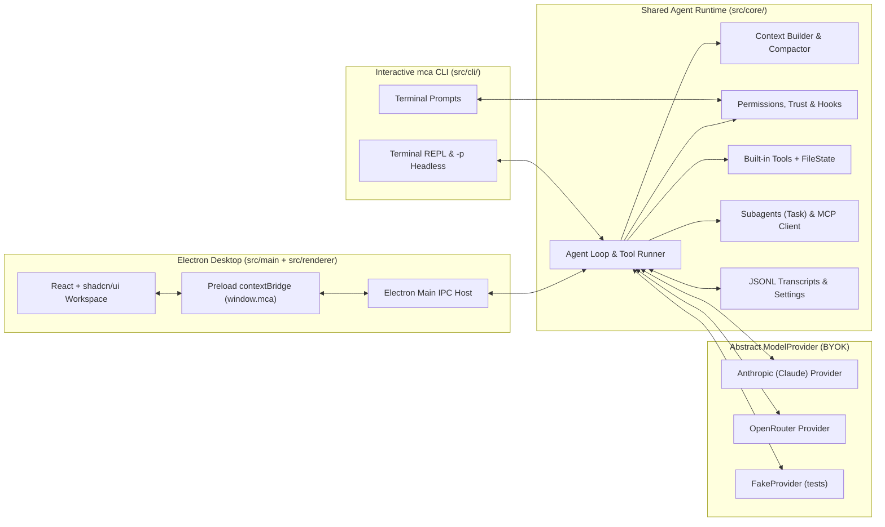

# Implementation Plan: mid-coding-agent (MCA)

> **Status (2026-11-21): the first implementation (Milestones 0–8) is complete and on `main`; `v0.1.0` is ready to tag.** This file is now the design reference. Open items from it (packaged-app and live-API verification, the Verification Plan's manual smoke tests) and all new work are tracked in [`HANDOVER.md`](HANDOVER.md) under *Backlog*. Boxes ticked below mean "implemented and covered by automated tests"; the two unticked ones need a Mac.

This plan adapts the **Build Claude Code from scratch** architecture (`mini-claude`, Stages 1–14) into **mid-coding-agent (MCA)**: a macOS-first **Electron + React + TypeScript + shadcn/ui** desktop app **and** an interactive **`mca` CLI** (like `claude` / `agy`), sharing one provider-agnostic TypeScript agent runtime.

**How to read this plan**: *Key Decisions* says what we build and why. *Core Contracts* are the four interfaces everything hangs off. *Edge-Case Rules* are binding requirements, grouped by module, and each one should become a test. *Milestones* are ordered so every milestone ends in something you can run.

---

## Key Decisions

1. **CLI first, desktop second.** `mca -p "<prompt>"` is the fastest feedback loop and needs no UI. The runtime is proven headless (Milestones 1–3) before any React work starts. The desktop app is then a second renderer of the same event stream, not a second implementation.
2. **One runtime, two thin frontends.** `src/core/` is pure Node with zero Electron or React imports. A frontend only (a) renders `AgentEvent`s and (b) answers `Frontend.ask()` prompts. Nothing else crosses the boundary.
3. **Canonical message format = Anthropic-style content blocks** (`text`, `tool_use`, `tool_result`). The Anthropic provider is close to a pass-through; the OpenRouter provider converts to and from OpenAI chat format. Transcripts are stored in the canonical format, so a session can switch provider or model mid-conversation.
4. **BYOK with one credential store for both frontends.** Lookup order: environment (`ANTHROPIC_API_KEY` / `OPENROUTER_API_KEY`) → macOS Keychain via `/usr/bin/security` (service `mca`, account = provider id) → `~/.mca/credentials.json` (`0600`, non-macOS fallback). A key saved in the desktop app therefore works in the CLI and vice versa, with no native module and no `safeStorage` split. Keys never reach the renderer; it only sees `hasKey: boolean`.
5. **ripgrep powers both `Grep` and `Glob`.** `Glob` is `rg --files --hidden -g <pattern> -g '!.git' --sortr modified`, which respects `.gitignore` for free and removes the `fast-glob` dependency. The binary comes from `@vscode/ripgrep` so users need nothing installed. Resolution order: `MCA_RG_PATH` → bundled binary → `rg` on `PATH`.
6. **One process helper.** `core/exec.ts` (spawn, process-group kill, timeout, abort, bounded output) is shared by `Bash`, hooks, git snapshots and `rg`. Process edge cases are solved once.
7. **Config compatibility.** Primary storage is `.mca/` (project) and `~/.mca/` (user). Compatibility fallbacks are read-only: `AGENTS.md`, `CLAUDE.md`, `CLAUDE.local.md`, `.mcp.json`, and `.claude/` `settings.json`, `commands/*.md`, `skills/<name>/SKILL.md`. When both exist, `.mca/` beats `.claude/` and project beats user.
8. **Workspace trust.** A cloned repo can ship hooks, MCP servers and `allow` rules, all of which execute code. Until the user trusts a workspace (recorded in `~/.mca/state.json`), project-level hooks, MCP servers and `allow` rules are ignored; `deny` and `ask` rules always apply. Headless mode is untrusted unless `--trust` is passed.
9. **UI consistency and language.** Any shadcn/ui component may be added (`npx shadcn@latest add <component>`) and should be preferred over ad-hoc controls. All UI text, CLI output, errors and docs are English-only.
10. **Small dependency budget.** Runtime additions: `@anthropic-ai/sdk`, `zod` (v4), `@vscode/ripgrep`, `picomatch`, `@modelcontextprotocol/sdk`, `react-markdown`, `remark-gfm`. Everything else uses Node 22 built-ins (`fetch`, `node:readline/promises`, `node:util.parseArgs`).

### Out of Scope for v1
Extended thinking, image / PDF / notebook input, HTTP and SSE MCP transports, background shell jobs, `!command` and `@file` expansion inside slash commands, `MultiEdit`, multiple windows, transcript virtualization, auto-update, code signing and notarization, Windows and Linux packaging.

---

## Architecture Overview



### Core Design Principles
1. **One loop**: a single streaming model-call → tool-execution → repeat loop. Subagents reuse it with fresh history and their own `readState`.
2. **Few, sharp tools**: 11 built-ins (`Read`, `Write`, `Edit`, `Glob`, `Grep`, `Bash`, `TodoWrite`, `ExitPlanMode`, `Task`, `WebFetch`, `Skill`) plus dynamic MCP tools.
3. **Search like a developer**: `Glob` + `Grep` + `Read`, exact on symbols and never stale.
4. **Read before write**: `Edit` and `Write` verify freshness against `readState` and record rewind checkpoints.
5. **Human holds the keys**: read-only calls auto-run in parallel; everything else goes through modes, rules and an approval prompt.
6. **Context is the budget**: bounded tool output, subagents for broad exploration, fast-model summarization for `WebFetch`, auto-compaction at 80% of the context window.
7. **Everything is a file**: instructions, settings, commands, skills and transcripts are plain files the user can read and edit.
8. **Tools never throw at the model**: every failure becomes an `is_error` tool result with a message that says what to do next.

---

## Core Contracts

These four interfaces are written first (Milestone 1) and are the only coupling between modules.

```ts
// core/provider/types.ts
type Block =
  | { type: 'text'; text: string }
  | { type: 'tool_use'; id: string; name: string; input: unknown }
  | { type: 'tool_result'; tool_use_id: string; content: string; is_error?: boolean }
type Message = { role: 'user' | 'assistant'; content: Block[] }
type StopReason = 'end_turn' | 'tool_use' | 'max_tokens' | 'error'
type StreamEvent =
  | { type: 'text_delta'; text: string }
  | { type: 'tool_use'; id: string; name: string; input: unknown }  // emitted once, fully parsed
  | { type: 'usage'; contextTokens: number; outputTokens: number }  // contextTokens includes cached tokens
  | { type: 'stop'; reason: StopReason }
interface ModelProvider {
  id: 'anthropic' | 'openrouter' | 'fake'
  contextWindow(model: string): Promise<number>
  stream(req: { model: string; system: string; messages: Message[]; tools: ToolDef[];
                maxTokens: number; signal: AbortSignal }): AsyncIterable<StreamEvent>
}

// core/tool.ts
interface Tool<I = unknown> {
  name: string
  description: string
  schema: z.ZodType<I> | JsonSchema            // raw JSON Schema is what MCP tools provide
  readOnly: boolean | ((input: I) => boolean)  // a function lets Bash classify per command
  run(input: I, ctx: ToolContext): Promise<string>
}

// core/agent.ts — the only thing a frontend implements
interface Frontend {
  emit(event: AgentEvent): void
  ask(request: PermissionRequest | PlanRequest | TrustRequest): Promise<Decision>
}

// shared/types.ts — the only thing a frontend renders
type AgentEvent =
  | { type: 'turn_start' } | { type: 'text_delta'; text: string; parentId?: string }
  | { type: 'tool_start'; id: string; name: string; input: unknown; parentId?: string }
  | { type: 'tool_end'; id: string; result: string; isError: boolean }
  | { type: 'todos'; todos: Todo[] } | { type: 'usage'; contextTokens: number; contextWindow: number }
  | { type: 'notice'; level: 'info' | 'warn' | 'error'; message: string }
  | { type: 'turn_end'; reason: 'done' | 'aborted' | 'error' | 'max_iterations' }
```

`parentId` is the `Task` tool-use id, which is how both frontends nest subagent activity. IPC channels are declared once as a typed `IpcContract` map in `shared/types.ts`; preload and main both derive from it, so a renamed channel is a compile error.

---

## Target Project Structure

```text
src/
├── shared/
│   └── types.ts                  # AgentEvent, IpcContract, Todo, PermissionMode, Decision
├── core/                         # Pure Node/TS runtime (shared by CLI & Electron Main)
│   ├── provider/
│   │   ├── types.ts              # ModelProvider, Message/Block, StreamEvent
│   │   ├── anthropic.ts          # Anthropic streaming + prompt caching
│   │   ├── openrouter.ts         # OpenAI-format conversion + SSE parser
│   │   ├── fake.ts               # Scripted provider for tests and offline dev
│   │   ├── models.ts             # Default main/fast model ids, context-window table
│   │   └── factory.ts            # Provider registry & model routing
│   ├── exec.ts                   # Shared spawn helper (group kill, timeout, bounded output)
│   ├── env.ts                    # Login-shell environment resolution (PATH for GUI launches)
│   ├── paths.ts                  # resolve/realpath, inside-workspace and protected-path checks
│   ├── tool.ts                   # Stage 1: Tool contract, toToolDef(), truncate()
│   ├── agent.ts                  # Stage 2: runTurn(), runTools(), runOne(), runSubagent(), sealHistory()
│   ├── registry.ts               # Built-in + MCP tools in stable order
│   ├── filestate.ts              # Stage 3: readState + checkpoint stack
│   ├── permissions.ts            # Stage 6: modes, rules, Bash command splitting, decide()
│   ├── trust.ts                  # Workspace trust (~/.mca/state.json)
│   ├── hooks.ts                  # Stage 7: lifecycle shell hooks
│   ├── context.ts                # Stage 8: system prompt, instruction files, git snapshot
│   ├── compact.ts                # Stage 11: auto and manual compaction
│   ├── session.ts                # Stage 11: JSONL transcripts, resume, repair
│   ├── mcp.ts                    # Stage 12: stdio MCP client
│   ├── settings.ts               # Settings merge
│   ├── credentials.ts            # env → Keychain → 0600 file
│   ├── commands.ts               # Stage 13: slash commands
│   └── tools/
│       ├── files.ts              # Read, Write, Edit
│       ├── search.ts             # Glob, Grep
│       ├── bash.ts               # Bash + isReadOnlyCommand()
│       ├── todo.ts               # TodoWrite
│       ├── plan.ts               # ExitPlanMode
│       ├── task.ts               # Task
│       ├── web.ts                # WebFetch
│       └── skill.ts              # Skill
├── cli/                          # Stage 14
│   ├── index.ts                  # Arg parsing, REPL, Ctrl+C, headless mode
│   └── ui.ts                     # Terminal Frontend (⏺/⎿ output, prompts)
├── main/
│   ├── index.ts                  # BrowserWindow + app lifecycle
│   └── ipc.ts                    # Desktop Frontend: IpcContract handlers, event batching
├── preload/
│   ├── index.ts                  # contextBridge.exposeInMainWorld('mca', ...)
│   └── index.d.ts
└── renderer/src/
    ├── App.tsx
    ├── components/
    │   ├── ui/                   # shadcn/ui primitives
    │   ├── ChatTranscript.tsx    # Markdown + collapsible tool cards, nested subagents
    │   ├── PromptInput.tsx       # Composer, slash autocomplete, model/mode selector, Stop
    │   ├── PermissionDialog.tsx  # Yes / Yes for this session / No + feedback
    │   ├── PlanApprovalSheet.tsx # Plan review for ExitPlanMode
    │   ├── TodoSidebar.tsx       # Todos + workspace and session switcher
    │   └── SettingsDialog.tsx    # Providers, keys, rules, MCP status
    └── hooks/
        └── useAgentSession.ts    # Reduces AgentEvents into view state
```

### Build and Tooling Changes (Milestone 0)
- **CLI bundle**: add `esbuild` as a devDependency and a `build:cli` script: `esbuild src/cli/index.ts --bundle --platform=node --target=node22 --format=cjs --packages=external --banner:js="#!/usr/bin/env node" --outfile=out/cli/index.js`. `build` becomes `electron-vite build && npm run build:cli`. Add `"bin": { "mca": "./out/cli/index.js" }`.
- **Typecheck**: add `src/core/**/*` and `src/cli/**/*` to `tsconfig.node.json` `include`.
- **Tests**: `vitest.config.ts` currently forces `jsdom` for every file. Split into two `test.projects`: `core` (`environment: 'node'`, `src/{core,cli,main,shared}/**`) and `renderer` (`jsdom`, existing setup file).
- **Packaging**: add `asarUnpack: ['node_modules/@vscode/ripgrep/bin/**']` to `electron-builder.yml`, and map `app.asar` → `app.asar.unpacked` when resolving the bundled `rg` path. CI builds arm64 only (`macos-latest`). Pass `GITHUB_TOKEN` to `npm ci` in CI, because the ripgrep postinstall downloads from GitHub and is rate-limited without it.

---

## Edge-Case Rules

Each bullet is a requirement. Where a rule names a number, that number is a named constant in the module.

### Agent Loop (`agent.ts`)
- **History is always valid.** `sealHistory()` runs in a `finally` after every turn, whatever happened (success, abort, provider error, crash in a tool). It drops empty assistant messages and adds a synthetic `tool_result` (`"Interrupted before this tool ran."`, `is_error`) for every `tool_use` without one. Without this, the next request is rejected by both providers.
- **Tool failures are results.** Unknown tool name, schema validation failure, thrown exception and permission denial all become `is_error` results. Validation errors list the offending fields.
- **Empty tool output** becomes `"(no output)"`; providers reject empty content.
- **`max_tokens` stop**: a truncated `tool_use` is dropped (never executed with partial input) and a user message asks the model to continue in smaller steps.
- **Iteration cap**: 50 model calls per turn (25 for subagents), then `turn_end: max_iterations` with a notice. Configurable.
- **Batching**: consecutive read-only calls run in parallel with a concurrency limit of 8; results are appended in call order. Any non-read-only call runs alone.
- **Abort** cancels the stream, kills running child processes, resolves every pending `ask()` as a denial, then seals history. Text already streamed is kept.
- **One turn at a time per session.** A second `send` during a running turn is rejected; the frontends disable input rather than queueing.

### Providers
- **Retries**: 429, 529 and 5xx retry up to 4 times with exponential backoff and `retry-after`; 401/403 fail immediately with a message that names the env var and the settings location. No retry once any event has been emitted downstream.
- **Usage**: Anthropic reports cached tokens separately; `contextTokens = input_tokens + cache_read_input_tokens + cache_creation_input_tokens`. Using `input_tokens` alone makes auto-compaction never fire. If a provider sends no usage, estimate as characters ÷ 4.
- **Anthropic caching**: `cache_control: ephemeral` on the system prompt and on the last block of the last message. Tool order is stable (built-ins in fixed order, then MCP tools sorted by name) so the cache prefix survives.
- **OpenRouter conversion**: one assistant message with N `tool_use` blocks → one assistant message with N `tool_calls`; each `tool_result` → its own `role: "tool"` message, placed immediately after. Streamed tool-call arguments arrive as string fragments keyed by `index` and are concatenated before parsing. Unparseable arguments still produce a `tool_use` event, with the raw string, so validation fails normally and the model is told why.
- **OpenRouter stream**: ignore SSE comment lines (keep-alives), handle `data: [DONE]`, handle chunk boundaries that split a line, and treat a chunk carrying an `error` field as a provider error even though the HTTP status was 200. Send `usage: { include: true }`.
- **Context window**: Anthropic from the table in `models.ts` (default 200k); OpenRouter from `/api/v1/models` `context_length`, fetched once and cached (default 128k if the lookup fails).
- **Model ids** live only in `models.ts` and settings (`model`, `fastModel`). If no fast model is configured, the main model is used.

### Paths (`paths.ts`)
- Inputs may be absolute, relative to the session cwd, or start with `~`. All checks use the `realpath` of the nearest existing ancestor, so a symlink cannot escape the workspace.
- **Outside the workspace**: reads prompt; writes prompt even in `acceptEdits`.
- **Protected paths** always prompt for writes, in every mode except `bypassPermissions`: `.git/**`, `.mca/settings*.json`, `.claude/settings*.json`, `.mcp.json`, and anything under `~/.mca/`. Otherwise the agent could grant itself permissions or install a hook.
- **Sensitive reads** prompt by default (`**/.env*`, `~/.ssh/**`, `~/.aws/**`), implemented as built-in `ask` rules the user can override.

### File Tools (`files.ts`, `filestate.ts`)
- **Read**: directory → error suggesting `Glob`; missing file → error with the resolved path; NUL byte in the first 8 KB → "binary file" error; empty file → `"(file is empty)"`. Default limit 2,000 lines, 2,000 characters per line. A file over 256 KB with no `offset`/`limit` is refused with a hint to page or `Grep`. Output uses `cat -n` style line numbers; the tool description says they are not part of the file.
- **Freshness**: `readState` stores `mtimeMs` and a content hash. A changed `mtimeMs` with an identical hash is still fresh, which avoids false "file changed" errors from formatters and coarse timestamps. After its own `Write`/`Edit`, the tool updates `readState`, so consecutive edits need no re-read. A partial read counts as a read.
- **Write**: creating a new file needs no prior read; overwriting does. Parent directories are created.
- **Edit**: `old_string === new_string` → error; empty `old_string` → error pointing to `Write`; zero matches → error with a whitespace hint; more than one match without `replace_all` → error stating the count. Replacement uses a callback replacer so `$&` and `$1` are literal. If the file uses CRLF and `old_string` only matches after converting LF to CRLF, both strings are converted, preserving the file's line endings.
- **Checkpoints**: a stack with one entry per turn, mapping path → original bytes (or "did not exist"), recorded on first touch within the turn. Subagent writes record into the parent turn's entry. `/rewind` pops the top entry, restores files, removes that turn from history, and appends a `rewind` record to the transcript. Repeating it steps further back.
- **Known limits, stated in `/help`**: checkpoints are in memory (lost on restart) and do not cover changes made through `Bash`.

### Search (`search.ts`)
- `rg` exit code 1 means no matches (`"No matches."`); exit code 2 is an error and its stderr is returned, which covers invalid regexes.
- `Glob`: 100-result cap, newest first, with a line stating how many were omitted. `Grep`: `files_with_matches` by default, `content` mode with `--max-columns 300`, 20k-character cap.
- A search path that does not exist is an error, not an empty result.

### Bash (`bash.ts`, `exec.ts`)
- **Working directory persistence** uses an exit trap rather than parsing stdout: the command runs as `trap 'pwd -P > "$MCA_CWD_FILE"' EXIT; <command>` under `/bin/bash -c`. This survives `exit N` and cannot be confused by command output. If the file is missing (for example after `exec`), the cwd is unchanged. If the stored cwd has been deleted, reset to the workspace root with a notice. Only the cwd persists; environment variables do not, and the tool description says so.
- **Process groups**: spawn with `detached: true` and kill with `process.kill(-pid)`, `SIGTERM` then `SIGKILL` after 2 seconds. Killing only the shell leaves `npm` → `node` children running.
- **Completion**: resolve on the `exit` event plus a 100 ms drain, not on `close`. A backgrounded child that keeps the pipe open (`npm run dev &`) would otherwise hang the tool until timeout.
- **Non-interactive**: `stdin` is ignored; `GIT_TERMINAL_PROMPT=0`, `PAGER=cat`, `GIT_PAGER=cat`.
- **Bounded output**: keep the first and last 15k characters while streaming, never the whole stream in memory. ANSI escapes are stripped. A non-zero exit is reported as `Exit code N` in a normal result.
- **Timeout**: 120 s default, 600 s maximum; on timeout the result includes the partial output and says the command was killed.
- **Environment**: GUI apps launched from Finder get a minimal `PATH`, so `node`, `npm` and `git` from Homebrew or nvm are not found. `env.ts` resolves the login-shell environment once at startup (`$SHELL -ilc 'env -0'`, 3 s timeout, fall back to `process.env`) and every child process uses it. This also fixes `npx`-based MCP servers.

### Permissions (`permissions.ts`)
- **Decision order**, first match wins:
  1. `deny` rule → deny
  2. `plan` mode and the call is not read-only → deny with "plan mode: present a plan with ExitPlanMode"
  3. `ask` rule or protected path → prompt
  4. `bypassPermissions` → allow
  5. read-only call inside the workspace → allow
  6. `allow` rule or session rule → allow
  7. `acceptEdits` and the call is `Edit`/`Write` inside the workspace → allow
  8. otherwise → prompt
- **Bash is read-only per command.** `isReadOnlyCommand()` accepts a command only if every segment starts with an allowlisted read-only program (`ls`, `cat`, `pwd`, `git status|log|diff|show|branch`, `rg`, `wc`, and similar) and the command has no redirection, command substitution or backgrounding. This keeps `plan` mode useful and cuts prompts for harmless commands. When in doubt it returns `false`.
- **Bash rules cannot be bypassed by chaining.** Commands are split on `&&`, `||`, `;`, `|` and newlines with a quote-aware splitter. An `allow` rule applies only if every segment matches an allow rule; a `deny` rule applies if any segment matches. Commands containing `$(`, backticks or `<(` are never auto-allowed. So `Bash(npm run test:*)` does not allow `npm run test && rm -rf ~`.
- **Rule syntax**: `Tool`, `Bash(prefix:*)`, `Edit(glob)`, `Read(glob)`, `WebFetch(domain:host)`, `mcp__server__tool`. Path globs are matched with `picomatch` against the workspace-relative path.
- **"Yes for this session"** stores the narrowest useful rule: for a single simple Bash command, its first two words as a prefix; for a compound command, the exact string; for `Edit`/`Write`, all edits inside the workspace; otherwise the tool name.
- **Prompts are serialized** through one queue, so parallel subagents never show two dialogs at once.
- **No prompt available** (headless mode, or the window closed mid-prompt) → deny with a message naming `--permission-mode` and `--allowed-tools`.
- **A denial with feedback** returns the user's text to the model as the tool result.
- **Subagents** share the parent's mode and session rules. `Explore` receives only read-only tools.

### Hooks (`hooks.ts`)
- Events: `SessionStart`, `UserPromptSubmit`, `PreToolUse`, `PostToolUse`, `Stop`. Input is JSON on stdin; `PreToolUse`/`PostToolUse` take a tool-name matcher.
- Exit 0 → continue. Exit 2 → block and feed stderr to the model. Any other exit code, a spawn failure or the 60 s timeout → a warning notice and continue. A broken hook must never brick the session.
- A blocking `Stop` hook sets `stop_hook_active` on its next invocation and is capped at 3 consecutive blocks, to prevent an infinite loop.
- Project hooks run only in a trusted workspace.

### Context (`context.ts`)
- The system prompt is byte-stable for a session. Everything volatile (date, git snapshot, instruction files, skills index) goes in a `<system-reminder>` block in the first user message, which works identically on both providers.
- **Discovery order**: user files (`~/.mca/AGENTS.md`, `~/.claude/CLAUDE.md`), then each directory from the git root down to the cwd (`AGENTS.md`, `CLAUDE.md`, `CLAUDE.local.md`). Files are de-duplicated by `realpath` and by content hash, because `CLAUDE.md` is often a symlink to or copy of `AGENTS.md`.
- **`@import`**: resolved relative to the importing file, depth ≤ 5, with a visited set for cycles. Tokens inside code spans and code fences are not imports. A missing or binary target is left as literal text.
- **Budgets**: 40k characters per file and 100k in total, with a visible truncation marker.
- **Git snapshot**: skipped when not in a repo; each git command has a 2 s timeout; status is capped at 40 lines.

### Compaction (`compact.ts`)
- Checked after every model call, including mid-turn (after tool results are appended, when history is valid). Long tool-heavy turns overflow otherwise.
- The whole history is replaced by one summary message, so a `tool_use`/`tool_result` pair can never be split. The current todo list and the instruction reminder are re-attached, and `readState` is cleared.
- A "prompt too long" rejection triggers one forced compaction and one retry. If the compaction request itself is too long, the oldest half of the tool results are replaced with `"[cleared]"` first.
- Compaction uses the main model. The transcript gets a `compact` boundary record; resume loads from the last boundary.

### Sessions (`session.ts`)
- Path: `~/.mca/projects/<cwd with separators replaced>-<8-char hash>/<id>.jsonl`, mode `0600`. The hash prevents two paths from sanitizing to the same directory.
- The first line is a meta record (`version`, `cwd`, `provider`, `model`). One line is appended per complete message, never per delta.
- **Loading is tolerant**: unparseable lines (a crash mid-write) are skipped, then `sealHistory()` repairs the result. An unknown `version` is refused with a clear message rather than misread.
- `--continue` resumes the most recent session for the cwd; `--resume <id>` a specific one. Resuming with no sessions starts a new one and says so.

### MCP (`mcp.ts`)
- stdio servers only; other transports are listed as "unsupported" in status. `${VAR}` in `command`, `args` and `env` is expanded.
- Servers connect in parallel with a 10 s timeout each. A failed server is reported and skipped; it never blocks the session.
- Tool names are `mcp__<server>__<tool>`, sanitized to `[a-zA-Z0-9_-]` and capped at 64 characters; collisions get a numeric suffix. The server's JSON Schema is passed through unchanged.
- MCP tools are never treated as read-only, whatever annotations the server sends. Results are text only (other content becomes a placeholder) and capped at 25k characters.
- Child servers are killed on exit, on `SIGINT`/`SIGTERM`, and when the workspace changes. Servers start only in a trusted workspace.

### WebFetch, Task, Todos and Plan
- **WebFetch**: `http(s)` only, `http` upgraded to `https`. Same-host redirects are followed; a cross-host redirect returns the new URL for the model to request, so domain rules cannot be sidestepped. 30 s timeout, 5 MB download cap, non-text content types refused. HTML is reduced to text, capped at 100k characters, and summarized by the fast model with no tools and the page wrapped as untrusted data. Results are cached for 15 minutes.
- **Task**: depth 1 (subagents have no `Task` tool). `Explore` calls are read-only and may run in parallel; `general-purpose` calls run alone. The result is the subagent's final text, or an explicit "no output" message. Subagent messages are not stored in the parent history.
- **TodoWrite** replaces the whole list. More than one `in_progress` item is accepted with a warning in the result.
- **ExitPlanMode** outside `plan` mode returns an error. Approve restores the mode that was active before `plan`; reject returns the user's feedback and stays in `plan`. In headless mode the plan is printed and the run ends.

### Commands and Skills (`commands.ts`, `skill.ts`)
- Built-ins: `/help`, `/clear`, `/compact`, `/mode`, `/model`, `/provider`, `/rewind`, `/trust`, `/exit`. A built-in wins over a file with the same name.
- Custom commands support `$ARGUMENTS` and `$1`–`$9`. Frontmatter is parsed with a small `key: value` reader (`description`, `name`); malformed frontmatter is treated as body text.
- An unknown `/name` is a local error and is not sent to the model. Input that looks like a path (`/Users/...`, a second `/` in the first word) is sent as a normal prompt.
- The skills index in the context lists name and description only, capped at 200 characters each. `Skill` returns the `SKILL.md` body plus its directory, so the model can `Read` sibling files.

### CLI (`cli/`)
- Flags (`node:util.parseArgs`): `-p/--print`, `--continue`, `--resume`, `--provider`, `--model`, `--permission-mode`, `--allowed-tools`, `--trust`, `--version`, `--help`.
- **Headless**: the answer goes to stdout and tool activity to stderr, so output can be piped. Piped stdin is appended to the prompt. Exit codes: 0 success, 1 runtime error, 2 usage or missing key.
- **Ctrl+C**: during a turn it aborts the turn; at an empty prompt, a second press within 2 s exits.
- Spinners and colour are disabled when stdout is not a TTY or `NO_COLOR` is set. The spinner stops before any prompt is shown.
- Multi-line input uses a trailing `\`.

### Desktop (`main/`, `renderer/`)
- **Main owns the state.** The renderer calls `session:getState` on mount and rebuilds from it, so a reload or HMR update never loses the conversation.
- **Event batching**: main coalesces `text_delta` events and flushes every 30 ms, avoiding an IPC flood and a React render per token.
- **Markdown** renders through `react-markdown` + `remark-gfm` with raw HTML disabled. Links open in the system browser; `will-navigate` is blocked.
- **Tool cards** are collapsed by default and show a bounded preview.
- Sending is disabled while a turn runs (Stop is shown instead). Switching workspace or session is blocked during a turn.
- The existing `sandbox: true`, `contextIsolation: true`, `nodeIntegration: false` settings stay.
- Closing the window during a turn aborts it and kills child processes.
- With no key configured, the first screen is the provider setup, not an error after the first prompt.

---

## Build Milestones

Each milestone lists a **Demo**: the command or action that proves it is done.

### Milestone 0: Scaffolding
- [x] Apply *Build and Tooling Changes*: `esbuild` + `build:cli`, `bin`, `tsconfig.node.json` includes, Vitest projects, `asarUnpack`, CI token.
- [x] Add `@anthropic-ai/sdk`, `zod`, `@vscode/ripgrep`, `picomatch`.
- **Demo**: `npm run typecheck && npm test && npm run build` pass, and `node out/cli/index.js --version` prints the version.

### Milestone 1: Contracts, Providers and Headless Loop (Stages 1–2)
- [x] Write the *Core Contracts* in `provider/types.ts`, `tool.ts`, `shared/types.ts`.
- [x] `provider/fake.ts` (scripted events), then `anthropic.ts`, `openrouter.ts`, `models.ts`, `factory.ts`.
- [ ] `credentials.ts` (env → Keychain → file). Confirm the Keychain round-trip from both a terminal and the packaged app; if the packaged app triggers a Keychain prompt, fall back to the file store on that path.
- [x] `exec.ts`, `env.ts`, `tool.ts` (`toToolDef()`, middle-preserving `truncate()`).
- [x] `agent.ts`: `runTurn()`, `runTools()`, `runOne()`, `sealHistory()`; `Read` as the first tool.
- [x] `cli/index.ts` headless path with a plain-text `Frontend`.
- [x] Tests: both provider adapters against recorded streams (including split chunks, keep-alives, fragmented tool arguments, mid-stream error); `truncate()`; batching order; every *Agent Loop* rule using `FakeProvider`.
- **Demo**: `mca -p "read package.json and tell me the version"` works with `--provider anthropic` and `--provider openrouter`.

### Milestone 2: File Tools, Search and Bash (Stages 3–5)
- [x] `paths.ts`, `filestate.ts`, `tools/files.ts`, `tools/search.ts`, `tools/bash.ts`.
- [x] Minimal `--permission-mode bypassPermissions` flag (allow everything) so mutating tools can be exercised now; Milestone 3 replaces the stub with the real engine.
- [x] Tests: the *Paths*, *File Tools*, *Search* and *Bash* rules, in temporary directories. Include: stale and unread edits, `$&` literals, CRLF, symlink escape, `cd` persistence across `exit 3`, child-process kill on timeout, backgrounded process not hanging.
- **Demo**: `mca -p "add a test for X and run it" --permission-mode bypassPermissions` edits files and runs the tests.

### Milestone 3: Permissions, Trust and Interactive REPL (Stage 6)
- [x] `settings.ts`, `trust.ts`, `permissions.ts` (`decide()`, command splitter, `isReadOnlyCommand()`).
- [x] `cli/ui.ts`: streaming `⏺`/`⎿` output, numbered permission prompt, Ctrl+C handling, `/mode`, `/rewind`, `/help`, `/exit`.
- [x] Tests: a table-driven matrix of mode × rule × tool for the decision order; chained-command cases; headless denial.
- **Demo**: an interactive `mca` session prompts before an edit, "Yes for this session" stops the next prompt, and `/rewind` restores the file.

### Milestone 4: Desktop Vertical Slice
- [x] `main/ipc.ts`: `IpcContract` handlers (`session:send`, `session:abort`, `session:getState`, `workspace:select`, `settings:*`, `prompt:answer`), event batching, cleanup on quit.
- [x] `useAgentSession.ts`, `ChatTranscript.tsx`, `PromptInput.tsx`, `PermissionDialog.tsx`, `SettingsDialog.tsx` (provider and key setup), mode selector, rewind button.
- [x] Tests: `useAgentSession` reducer against event sequences; `PermissionDialog` returns each of the three decisions; `SettingsDialog` never renders a stored key.
- **Demo**: in `npm run dev`, set a key, open a repo, run a prompt that triggers `Read` → `Grep` → `Edit` (approved in the dialog) → `Bash`, then rewind.

### Milestone 5: Hooks and Project Context (Stages 7–8)
- [x] `hooks.ts` and `context.ts` (stable system prompt, first-turn reminder, instruction discovery, `@import`, git snapshot); Anthropic cache breakpoints.
- [x] Trust prompt in both frontends when a workspace has project hooks, MCP servers or allow rules.
- [x] Tests: discovery order and de-duplication, `@import` cycle and depth, exit-code handling for hooks, the `Stop` loop cap, untrusted workspace ignoring project hooks.
- **Demo**: a repo with `AGENTS.md` and a `PreToolUse` hook that blocks `rm` behaves accordingly; a second prompt in the same session reports cache-read tokens on Anthropic.

### Milestone 6: Planning, Subagents and WebFetch (Stages 9–10)
- [x] `tools/todo.ts` + `TodoSidebar.tsx`; `tools/plan.ts` + `PlanApprovalSheet.tsx` and the CLI plan prompt.
- [x] `runSubagent()` + `tools/task.ts`; nested rendering through `parentId` in both frontends.
- [x] `tools/web.ts`.
- [x] Tests: plan approve and reject mode transitions; subagent isolation (own `readState`, shared checkpoint, no `Task` tool); WebFetch redirect and size rules against a local HTTP server.
- **Demo**: in `plan` mode the agent explores with parallel `Explore` subagents, presents a plan, and executes it after approval while the todo list updates.

### Milestone 7: Sessions, Compaction and MCP (Stages 11–12)
- [x] `session.ts` with `--continue`, `--resume` and the desktop session switcher.
- [x] `compact.ts` with auto-trigger, `/compact [focus]` and the overflow retry.
- [x] Add `@modelcontextprotocol/sdk`; `mcp.ts`; MCP status in Settings and `/help`.
- [x] Tests: resume from a transcript with a truncated last line and a dangling `tool_use`; compaction trigger arithmetic with cached tokens; forced compaction on overflow using `FakeProvider`; MCP name sanitizing and a failing server not blocking startup.
- **Demo**: quit mid-session and `mca --continue` picks it up; a long session compacts and keeps working; a tool from a `.mcp.json` server is callable after approval.

### Milestone 8: Skills, Commands, Polish and Packaging (Stages 13–14)
- [x] `tools/skill.ts`, `commands.ts`, remaining built-ins, slash autocomplete in `PromptInput.tsx`.
- [x] Finalize `--help`; update `README.md` (CLI usage, key setup, config files, known limits).
- [ ] Verify the packaged app end to end, launched from Finder: bundled `rg` runs, `Bash` finds `node` and `git`, Keychain key is read.
- **Demo**: the *Verification Plan* passes in full.

---

## Verification Plan
- **Automated (Vitest)**: one test file per `src/core/` module, driven by the *Edge-Case Rules*. Agent-loop, compaction and CLI tests use `FakeProvider`; no test touches the network. React Testing Library covers `App`, `ChatTranscript`, `PermissionDialog`, `SettingsDialog` and the `useAgentSession` reducer.
- **CI** (`.github/workflows/ci.yml`, `macos-latest`): `typecheck`, `test`, `build`, `package:mac` on every push and pull request to `main`.
- **Manual smoke tests (macOS)**:
  - CLI: an interactive session in a repo covering `/mode`, `/model`, `/rewind`, `/compact`; `mca -p "summarize this repo"`; `echo "..." | mca -p "review this"`; Ctrl+C during a long `Bash` command leaves no child process behind.
  - Desktop (`npm run dev`): configure a key, open a repo, run `Read` → `Grep` → `Edit` (approve) → `Bash(npm test)` → rewind; reload the window mid-conversation and confirm the transcript is intact.
  - Packaged app from Finder: the same flow, to confirm `PATH` resolution and the bundled `rg`.
  - Untrusted repo containing a hook and an `allow` rule: neither takes effect until trust is granted.
